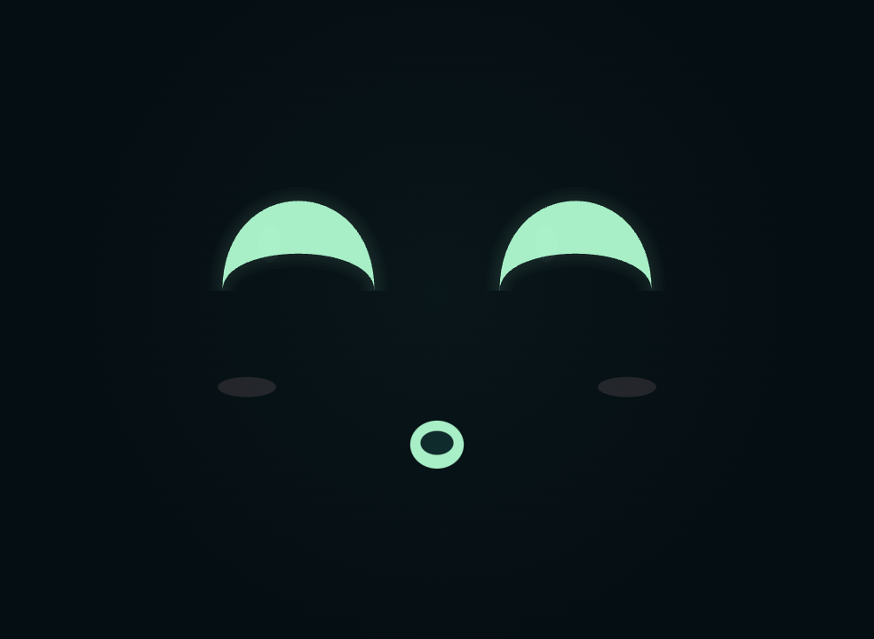
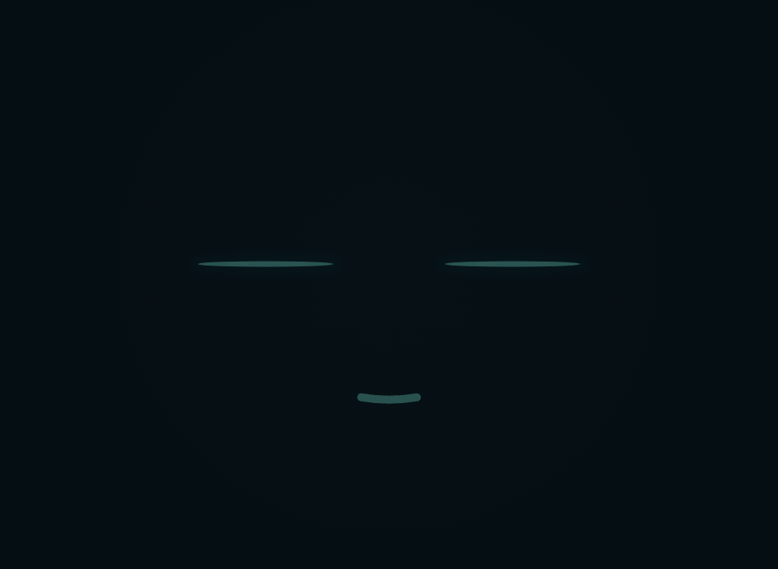

# Ken Animation v1 trên Android

Ngày triển khai: 09/10/2026. Thiết kế đã được người dùng duyệt trong
[bản xem trước](KEN_ANIMATION_PREVIEW.html).

## Bộ animation đã thay

Màn Ken, Hội thoại, Thị giác và chế độ đế dùng chung `KenFace` Compose Canvas,
`KenMotionEngine` và đồng hồ chuyển động. Các wrapper `RobotEyes`,
`CompanionFace`, `DockFace` giữ điểm gọi hiện có và chuyển sang bộ dựng hình mới.

- 8 trạng thái hội thoại, 5 sắc thái cảm xúc.
- 12 phản ứng cử chỉ và phản ứng khi chạm mặt; nét vẽ vector thay hiệu ứng emoji.
- Mắt bạc hà, má hồng, mắt tim, miệng nhỏ; chuyển biểu cảm bằng spring giữ vận tốc.
- Mắt nhìn trước, mặt theo sau; hướng nhìn dùng dữ liệu gaze hiện có.
- Mặt và nhịp nhạc dùng chung chu kỳ 1,2 giây. Nhạc là hiệu ứng trang trí,
  không phân tích beat từ bản nhạc.
- Miệng dùng RMS của PCM đã giải mã, theo vị trí phát của `AudioTrack`.
  Chỉ trạng thái `SPEAKING` mở miệng theo âm lượng; dừng phát xóa mức âm lượng.
- Ngủ và lỗi ưu tiên cao hơn cử chỉ. Phản ứng bị bỏ khi ngủ không phát lại khi thức.
- Khi Android tắt animation hệ thống, bỏ chuyển động lặp, nhún và lắc;
  vẫn giữ biểu cảm và ký hiệu trạng thái.
- Đồng hồ dừng khi app ra nền hoặc mặt không nằm trong tab đang hiển thị.

Thông số hình học, bảng cử chỉ và nhịp chuyển động nằm trong
[đặc tả thiết kế](KEN_ANIMATION_V1_VI.md).

## Mã nguồn chính

- `android-app/robot-app/domain/src/main/kotlin/com/robotai/domain/KenMotion.kt`:
  pose, ưu tiên, timing, spring và phong bì PCM.
- `android-app/robot-app/app/src/main/java/com/robotai/robot/motion/KenFace.kt`:
  renderer, đồng hồ Compose, vòng đời và reduced motion.
- `android-app/robot-app/app/src/main/java/com/robotai/robot/data/StreamPlayer.kt`:
  mức PCM tại vị trí đang phát, xóa mức khi dừng.

## Giới hạn kiểm chứng

Kiểm tra âm thanh dùng Opus tạo từ tín hiệu có tiếng và đoạn im lặng, phát qua
`AudioTrack` thật. Kiểm tra nhạc dùng file MP3 qua máy chủ local.
Đây chưa phải kiểm chứng toàn bộ cuộc hội thoại STT/backend/TTS trực tiếp.
Chưa đo frame time dài hạn hoặc mức tiêu thụ pin.

## Kết quả kiểm chứng

- Build debug và APK kiểm thử Android: đạt.
- 80 kiểm tra JVM: 6 trong app, 74 trong domain; không lỗi hoặc bỏ qua.
- 5 kiểm tra trên OPPO CPH2651: đạt. Bao gồm mọi trạng thái ở hai tỉ lệ
  màn hình, 12 phản ứng vector hết hạn đúng lúc và không chặn nút,
  chú thích cử chỉ, audio có tiếng/im lặng ở 16/24 kHz và điều khiển nhạc.
- Đã cập nhật `com.robotai.robot` bằng cài đặt thay thế, giữ dữ liệu app.
  SHA256 APK trên điện thoại khớp bản build local.
- Hai kiểm tra bổ sung cho wrapper Ken/chế độ đế chưa hoàn tất do điện thoại
  khóa màn hình. Runner báo không có cây Compose khi app bị che bởi màn khóa.

Ảnh chụp từ renderer Android trên thiết bị, dùng dữ liệu thử:

| Bình yên | Đang nói |
| --- | --- |
|  |  |

| Thả tim | Ngủ |
| --- | --- |
|  |  |
