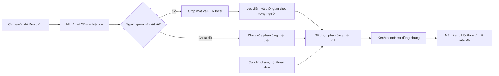

# Nhận diện biểu cảm người quen và phản ứng màn hình Ken

Ngày nghiên cứu: 11/10/2026. Đối chiếu mã nguồn đang có trong workspace và tài liệu chính thức của Google, OpenCV, tác giả mô hình. Đây là nghiên cứu và thiết kế tích hợp; chưa thêm mô hình vào APK, chưa đo độ chính xác hoặc hiệu năng cảm xúc trên OPPO.

Sau bản nghiên cứu này, tính năng đã được triển khai: xem [hướng dẫn sử dụng và kiểm chứng](KNOWN_PERSON_EXPRESSIONS_VI.md). Các nhận xét hiện trạng phía dưới mô tả thời điểm nghiên cứu trước triển khai.

## 1. Kết luận cho RobotAI

Có thể đáp ứng yêu cầu: **Ken đang thức, người quen xuất hiện và có biểu cảm rõ → Ken phản ứng bằng mắt/miệng trên màn hình, dù người đó không nói và không có lượt hội thoại**.

Đề xuất triển khai trên Android, sử dụng camera và SFace hiện có, thêm bộ phân loại biểu cảm khuôn mặt nhẹ chạy ONNX. Ứng viên đầu tiên để thử là **Progressive Teacher với backbone MobileFaceNet trong OpenCV Zoo**. Lý do lựa chọn là tương thích với hạ tầng nhận mặt và ONNX Runtime của dự án; chưa có bằng chứng đây là mô hình chính xác nhất trên người dùng thực tế của Ken.

Tách thành ba quyết định:

1. **Ai đang ở đó?** SFace và bộ theo dõi người hiện có xác nhận người quen.
2. **Khuôn mặt đang biểu hiện gì?** Mô hình FER (Facial Expression Recognition) đọc ảnh mặt; ML Kit nhận nụ cười làm phương án đối chứng đơn giản.
3. **Ken nên phản ứng thế nào?** Bộ quy tắc theo thời gian chuyển tín hiệu thành `HAPPY`, `CARING`, `CURIOUS` hoặc `CALM`, đồng thời phối hợp với cử chỉ, nhạc và hội thoại.

Camera có thể quan sát liên tục khi thức; mô hình biểu cảm chỉ cần chạy khoảng 3–5 lần/giây lúc có mặt đủ rõ. Đây là nhịp khởi đầu đề xuất, phải đo trên điện thoại trước khi chốt.

“Nhận diện cảm xúc” trong tính năng này nên được hiểu là **ước lượng biểu cảm đang thấy**. Biểu cảm không đủ để xác định chắc chắn trạng thái bên trong: nhíu mày có thể do tập trung, mở miệng có thể do nói/ngáp, cười có thể là xã giao. Tổng quan nghiên cứu của Barrett và cộng sự chỉ ra giới hạn về tính nhất quán, tính đặc hiệu và khả năng khái quát khi suy cảm xúc từ chuyển động mặt. Vì vậy Ken phản ứng nhẹ, có trạng thái chưa rõ và không khẳng định người dùng đang buồn/giận chỉ từ camera. [Nghiên cứu gốc](https://affective-science.org/wp-content/uploads/2024/04/barrett-et-al-2019-emotional-expressions-reconsidered-challenges-to-inferring-emotion-from-human-facial-movements.pdf).

## 2. Dự án đã có gì và cần nối ở đâu?

| Thành phần | Hiện trạng trong code | Ý nghĩa với tính năng mới |
|---|---|---|
| [CameraHost.kt](../android-app/robot-app/app/src/main/java/com/robotai/robot/identity/CameraHost.kt) | CameraX hoạt động khi `awake && allowed && resumed`, độc lập preview và kết nối hội thoại; ảnh mục tiêu 640×480, chỉ giữ frame mới nhất | Không cần tạo camera riêng hoặc yêu cầu người dùng nói trước |
| Cấu hình ML Kit trong CameraHost | FAST, landmark và tracking; chưa bật `CLASSIFICATION_MODE_ALL` | Hiện chưa lấy được tín hiệu nụ cười để làm phản ứng |
| [IdentityController.kt](../android-app/robot-app/app/src/main/java/com/robotai/robot/identity/IdentityController.kt) | Phân tích sâu danh tính theo khoảng 500 ms hoặc khi track thay đổi; nhánh nhanh vẫn xử lý cử chỉ | Biểu cảm cần lịch chạy riêng; tránh bị bỏ qua do `return` sớm ở nhánh nhanh |
| [PersonTracking.kt](../android-app/robot-app/domain/src/main/kotlin/com/robotai/domain/PersonTracking.kt) | Xác nhận danh tính sau 3 quan sát phù hợp; có nguồn FACE/BODY/FACE_GRACE | Giữ người qua cơ thể giúp theo dõi, nhưng không chứng minh có mặt rõ để đọc biểu cảm |
| [FaceEmbedding.kt](../android-app/robot-app/app/src/main/java/com/robotai/robot/identity/FaceEmbedding.kt) | Căn mặt bằng 5 điểm, tạo RGB 112×112; đầu vào SFace là float 0–255 | Có thể dùng chung phép căn mặt; bộ phân loại biểu cảm cần chuẩn hóa riêng |
| [Companion.kt](../android-app/robot-app/domain/src/main/kotlin/com/robotai/domain/Companion.kt) | Mood lấy từ câu trả lời, emotion do backend báo, chạm và sự hiện diện khuôn mặt | `speechEmotion` hiện là tín hiệu phía câu trả lời của robot; chưa phải cảm xúc đọc từ mặt người |
| [CompanionScreen.kt](../android-app/robot-app/app/src/main/java/com/robotai/robot/companion/CompanionScreen.kt) | Cung cấp `KenMotionInput` cho host dùng chung, cử chỉ có phản ứng riêng | Điểm ghép biểu cảm quan sát vào animation chung |
| [KenFace.kt](../android-app/robot-app/app/src/main/java/com/robotai/robot/motion/KenFace.kt) | `KenFace` ưu tiên pose được host cung cấp qua CompositionLocal | Khi ở trong host, chỉ đổi tham số của mặt con hoặc DockFace sẽ không đổi pose chung |
| [KenMotion.kt](../android-app/robot-app/domain/src/main/kotlin/com/robotai/domain/KenMotion.kt) | Đã có mood và spring chuyển động, miệng theo audio khi SPEAKING | Tái sử dụng animation; cần giữ miệng nói và trạng thái xử lý câu đúng |

Một điểm dễ bỏ sót: `CompanionMind.mood()` ưu tiên `CURIOUS` trong `LISTENING`, `THINKING`, `FINALIZING`. Ken có thể ở `LISTENING` khi đang chờ mà người quen im lặng. Nếu chỉ thêm cảm xúc vào nhánh `IDLE`, yêu cầu của người dùng sẽ không được đáp ứng. Cần phân biệt **chờ nghe** với **đang nhận lời nói**, dùng tín hiệu VAD/hoạt động lời nói thay vì chỉ kiểm tra tên phase.

Code hiện tại là căn cứ chính; một số đoạn tài liệu nhận diện cũ chưa phản ánh toàn bộ phần TalkNet và hội thoại riêng đang có trong workspace.

## 3. So sánh kỹ thuật

| Hướng | Đọc được gì? | Phù hợp với RobotAI | Hạn chế cần tính |
|---|---|---|---|
| ML Kit Face Classification | Nụ cười, mắt mở/nhắm | Ít thay đổi vì detector đã có; tốt để thử phản ứng cười | Không có bộ nhãn buồn/giận/ngạc nhiên; không cười không có nghĩa là buồn |
| MediaPipe Face Landmarker + blendshapes | Hình học mặt và hệ số chuyển động mắt, miệng, lông mày | Hữu ích cho animation theo biểu cảm và tín hiệu bổ sung | Cần thêm model bundle và suy diễn/huấn luyện lớp phân loại; blendshape không phải xác suất cảm xúc |
| CNN FER nhẹ chạy ONNX/TFLite | Nhãn biểu cảm học từ ảnh mặt | Phù hợp khi cần cả vui, buồn và ngạc nhiên; hạ tầng ONNX đã sẵn | Sai số ảnh ngoài thực tế, góc mặt, ánh sáng, khác biệt người; phải lọc thời gian |
| Valence–arousal | Hai trục tích cực/tiêu cực và mức kích hoạt | Có thể giúp điều chỉnh cường độ phản ứng về sau | Khó giải thích và hiệu chỉnh; không cần cho phiên bản đầu |
| Kết hợp mặt + giọng + lời nói | Bằng chứng đa nguồn khi người dùng nói | Hướng mở rộng cho hội thoại | Giọng/lời nói vắng mặt trong yêu cầu này; không nên là điều kiện để phản ứng màn hình |
| VLM/cloud đọc ảnh | Mô tả biểu cảm kèm ngữ cảnh cảnh | Hợp với hỏi về cảnh hoặc phân tích theo yêu cầu | Thêm độ trễ, truyền ảnh và phụ thuộc mạng; khó phù hợp vòng phản ứng thường trực |

### ML Kit: phương án nụ cười tối giản

Bật `setClassificationMode(FaceDetectorOptions.CLASSIFICATION_MODE_ALL)` và đọc `smilingProbability`. Giá trị vắng mặt phải là chưa biết, không thay bằng 0. Phân loại nụ cười/mắt của ML Kit dùng cho mặt gần chính diện; Google mô tả góc Euler Y từ −18° tới +18°. Chỉ bật classification với landmark/tracking hiện có; không cần bật contour cho tính năng này. [API Android](https://developers.google.com/ml-kit/vision/face-detection/android), [giới hạn góc mặt](https://developers.google.com/ml-kit/vision/face-detection/face-detection-concepts).

Đây là baseline tốt để đo: người quen cười → Ken cười lại. Cần mô hình FER nếu muốn mở rộng đến biểu cảm buồn/ngạc nhiên.

### MediaPipe: chuyển động khuôn mặt

Face Landmarker trả 478 điểm mặt và tùy chọn 52 blendshapes, ví dụ chuyển động khóe miệng, mí mắt, lông mày. Đây là các hệ số chuyển động; không có đầu ra trực tiếp “buồn 80%”. [Tổng quan model](https://developers.google.com/edge/mediapipe/solutions/vision/face_landmarker).

Có thể dùng `mouthSmileLeft/Right` để điều chỉnh mức cười, hoặc kết hợp các tín hiệu để thử lớp phân loại biểu cảm. Quy tắc “nhíu mày = giận” hoặc “nhắm mắt = buồn ngủ” chưa đủ tin cậy. Model card nêu chất lượng đầu ra chịu ảnh hưởng ánh sáng, nhiễu, chuyển động và khuôn mặt chồng lấp. [Model card Blendshape V2](https://storage.googleapis.com/mediapipe-assets/Model%20Card%20Blendshape%20V2.pdf).

Nếu thử MediaPipe: bật `outputFaceBlendshapes`, dùng VIDEO trên worker hoặc LIVE_STREAM với callback, timestamp đơn điệu. Google chỉ áp dụng smoothing tích hợp khi `numFaces=1`; khi nhiều mặt vẫn phải ghép đúng vùng mặt với `personId`, không lấy mặt đầu tiên. Crop người đã chọn là một phương án, nhưng bộ kiểm tra nhiều người phải dựa vào cảnh gốc. LIVE_STREAM cần giữ ảnh hợp lệ đến khi xử lý xong. [Hướng dẫn Android](https://developers.google.com/edge/mediapipe/solutions/vision/face_landmarker/android).

Dự án đã có `tasks-vision:0.10.14`, nhưng chưa có asset Face Landmarker. Phải xác minh API/model tương thích với bản đang dùng; không đổi sang `latest.release` chỉ để chạy thử.

### FER: ứng viên cho bản vui/buồn/ngạc nhiên

**OpenCV Zoo Progressive Teacher / MobileFaceNet** có 7 lớp: angry, disgust, fearful, happy, neutral, sad, surprised; model ONNX và giấy phép Apache 2.0 được công bố trong thư mục model. README báo accuracy 88,27% trên RAF-DB. Đây là số của tập đánh giá đó, không phải độ chính xác đã đo trên camera Ken hoặc người Việt Nam. [Model và benchmark](https://github.com/opencv/opencv_zoo/tree/main/models/facial_expression_recognition).

Mã suy luận tham chiếu căn mặt 5 điểm vào 112×112, chuyển RGB và chuẩn hóa `(pixel/255 − 0.5)/0.5`, sau đó dùng thứ tự lớp trên. Dự án đang dùng cùng các tọa độ đích căn mặt, nên có thể tách hàm tạo crop dùng chung. **Không dùng trực tiếp tensor SFace 0–255 cho FER**. Phải kiểm tra shape, tên đầu vào/đầu ra và logits/softmax của đúng file ONNX; demo lấy argmax chưa chứng minh điểm đầu ra là xác suất đã hiệu chỉnh. [Mã tham chiếu](https://github.com/opencv/opencv_zoo/blob/main/models/facial_expression_recognition/facial_fer_model.py).

**EmotiEffLib, trước đây là HSEmotion**, là ứng viên đối chứng nếu mô hình trên không đủ tốt. Kho tác giả có backend ONNX, các model MobileNet/EfficientNet và ví dụ mobile. Bảng công bố trên Samsung Fold 3 Snapdragon 888 ghi MobileNet khoảng 16 ± 5 ms, EfficientNet-B0 khoảng 59 ± 26 ms, B2 khoảng 191 ± 18 ms. Không chuyển các con số này thành dự báo OPPO, cũng không so trực tiếp accuracy AffectNet với RAF-DB để xếp hạng. [Kho tác giả và bảng đo](https://github.com/sb-ai-lab/EmotiEffLib).

Khi chốt bất kỳ model nào, pin phiên bản/file, SHA-256, preprocessing, thứ tự nhãn và giấy phép của model cụ thể cùng thông tin dữ liệu huấn luyện. Không chỉ dựa vào giấy phép của thư viện chạy inference.

## 4. Luồng tích hợp đề xuất

### Điều kiện chạy và ghép đúng người

- Robot thức, app foreground, quyền camera hợp lệ, tính năng được bật.
- Danh tính mặt đã xác nhận; không yêu cầu mẫu giọng, microphone hay WebSocket để đọc biểu cảm.
- Bản đầu phản ứng khi chỉ có một người hiện diện rõ và người đó là người quen. Có nhiều người hoặc liên kết mơ hồ thì không chọn cảm xúc ngẫu nhiên. Về sau có thể chọn một mục tiêu ổn định với trạng thái riêng từng người.
- Có mặt trong **frame đang phân tích**, liên kết đúng detector track và person track. Theo dõi BODY riêng không cho phép đọc một biểu cảm mới; không dùng cảm xúc cũ của mặt đã quay đi.
- Đặt kiểm tra kích thước, ánh sáng, mờ, che khuất và góc mặt. Khởi đầu thử mặt rộng ít nhất 120 px trong bitmap đã xoay, yaw ≤20°, pitch ≤15°; đây là tham số đề xuất cho thử nghiệm, không phải giới hạn đã được model bảo đảm.
- Reset khi đổi người, đổi camera, đổi cảnh, mất mặt quá thời hạn, ngủ, vào nền, đăng xuất/đổi tài khoản. Tạm dừng khi đăng ký mặt/giọng hoặc dạy cử chỉ. Xóa trạng thái nếu xóa hồ sơ người đang nhận diện.

Giữ snapshot danh tính cùng frame; khóa trạng thái bằng `(cameraEpoch, trackId, personId, capturedAt)`. Kết quả suy luận đến muộn chỉ được nhận khi khóa vẫn hợp lệ và ảnh còn đủ mới. Tránh gán biểu cảm người A cho B khi đổi người trong lúc inference đang chạy.

### Lọc thời gian và tránh nhấp nháy

Tham số khởi đầu để đo, chưa phải cấu hình đã nghiệm thu:

| Tham số | Đề xuất thử |
|---|---|
| Nhịp chạy FER | 3–5 Hz; giảm/bỏ frame khi tài nguyên bận |
| Xác nhận cười | 600–900 ms, ít nhất 3 quan sát đạt điều kiện |
| Xác nhận biểu cảm buồn | 1.500–2.000 ms, ít nhất 5 quan sát đạt điều kiện |
| Xác nhận ngạc nhiên | 800–1.200 ms, ít nhất 3 quan sát; không dùng mở miệng đơn độc |
| Khoảng trống tối đa giữa quan sát | Khoảng 500 ms; vượt thì khởi động xác nhận lại |
| Tuổi kết quả inference khi chấp nhận | Không quá khoảng 500 ms |
| Giữ chuyển động ngắn đã xác nhận | Khoảng 2–3 giây; không cấp lại từ kết quả cũ |
| Mất mặt | Bắt đầu hạ cường độ sau khoảng 500 ms, hết mood camera trong khoảng 1.500 ms |
| Phát lại một hiệu ứng nhấn mạnh | Chỉ khi biểu cảm đã hạ rồi xuất hiện lại; cooldown khoảng 8–15 giây |

Điểm cần đủ cao và cách biệt lớp đứng thứ hai. Sau khi xác minh đầu ra là phân bố softmax, có thể thử điểm bắt đầu 0,70 và khoảng cách 0,20, rồi hiệu chỉnh trên dữ liệu thật. Không áp các ngưỡng đó vào logits; không hiển thị “70% chắc chắn người đang buồn”. Nếu dùng ML Kit smile, hiệu chỉnh ngưỡng riêng.

Dùng smoothing theo thời gian, hysteresis (ngưỡng bắt đầu cao hơn ngưỡng duy trì) và tuổi dữ liệu. Đo thời gian thực bằng đồng hồ đơn điệu; không chỉ đếm frame vì pipeline có thể chậm khi nhận giọng hoặc chạy pose. Sự kiện hết hạn không tự xuất hiện lại khi chuyển tab.

### Ken phản ứng thế nào?

| Tình huống quan sát | Phản ứng đề xuất |
|---|---|
| Người quen vừa xuất hiện, chưa có biểu cảm rõ | Ken hướng nhìn về mặt, biểu hiện chú ý nhẹ; một lần mỗi lần xuất hiện |
| Nụ cười/biểu cảm vui ổn định | Mắt cong và miệng cười, `Mood.HAPPY`; không liên tục phát confetti |
| Biểu cảm buồn rõ, duy trì đủ lâu | Mắt mềm và nghiêng nhẹ, `Mood.CARING`; không tự hiển thị kết luận “Bạn đang buồn” |
| Ngạc nhiên rõ | Mắt mở hơn, `Mood.CURIOUS`; cường độ vừa phải |
| Neutral | `Mood.CALM`, vẫn hướng nhìn về người |
| Nhãn giận/sợ/ghê, điểm thấp hoặc xung đột | Chưa rõ; giữ chú ý nhẹ. Chỉ mở rộng phản ứng sau khi thử thật |
| Người quay mặt, mất dấu, người lạ/nhiều người | Hạ mood camera về nền, không suy diễn biểu cảm mới |

Nhãn quan sát và mood của Ken là hai loại dữ liệu khác nhau. Ken có thể phản ứng quan tâm trước biểu cảm buồn thay vì sao chép một mặt buồn. Biểu cảm âm tính cần được kiểm chứng khó hơn nụ cười.

### Phối hợp với tính năng hiện có

1. Ngủ/lỗi và vòng đời app quyết định trạng thái nền; không có phản ứng camera mới khi ngủ.
2. Cử chỉ/chạm vừa xác nhận có ưu tiên cho hiệu ứng ngắn đang chạy.
3. Khi Ken nói, giữ mouth theo PCM và mood câu trả lời; quan sát camera không làm đổi nội dung hoặc mở lượt nói.
4. Khi đang xử lý câu hoặc có lời nói thật, giảm/hoãn hiệu ứng camera mạnh. **Khi LISTENING nhưng đang yên lặng, vẫn cho phép phản ứng nhẹ với mặt người quen.**
5. Lúc chờ hoặc idle, dùng mood camera đã xác nhận rồi mới đến mood nền. Nhạc có thể giữ nhịp chuyển động; cảm xúc đổi nhẹ mắt/miệng theo quy tắc đã chọn.

Sự hiện diện hoặc cười thụ động không nên gọi `vm.interaction()` ở mọi frame: cách đó sẽ làm Ken không bao giờ tự ngủ. Đề xuất giữ chính sách ngủ hiện tại, camera dừng khi ngủ; chỉ tính tương tác chủ động đã có. Nếu muốn “có người quen ở cạnh thì luôn tỉnh”, cần một chính sách hiện diện riêng để người dùng lựa chọn.

## 5. Các thay đổi cụ thể khi triển khai

Các tên file mới dưới đây là đề xuất, chưa được tạo:

| Vị trí | Công việc |
|---|---|
| `identity/FaceCropper.kt` mới | Tách crop căn 5 điểm từ FaceEmbedding; giữ riêng preprocessing từng model, xác minh không làm thay đổi embedding hiện có |
| `identity/FacialExpressionDetector.kt` mới | Load model FER local; kiểm input/output, thứ tự nhãn; trả điểm và chất lượng, giải phóng tensor/session |
| `domain/FacialExpression.kt` mới | Enum biểu cảm có UNKNOWN, dữ liệu quan sát theo người, smoothing/hysteresis/TTL và state machine |
| `IdentityController.kt` | Thêm lịch FER và kết quả quan sát vào state; cả nhánh nhanh/chậm đều có cơ hội chạy; reset theo cameraEpoch và danh tính |
| `CameraHost.kt` | Bật classification nếu dùng baseline smile; duy trì camera độc lập hội thoại |
| `domain/VisualReactionPolicy.kt` mới | Chọn mood/cường độ từ hiện diện, biểu cảm, cử chỉ, lời nói và nhạc |
| `CompanionScreen.kt` | Truyền kết quả bộ chọn vào `KenMotionInput` của host chung; hướng nhìn cùng người sở hữu biểu cảm |
| `KenMotion.kt` | Điều chỉnh pha LISTENING và mức mood nếu cần để phản ứng nhìn thấy khi chờ nghe; giữ mouth audio khi nói |
| `PeoplePanel.kt` | Công tắc phản ứng biểu cảm riêng; trạng thái “đang đọc/chưa đủ rõ”, không dùng lỗi biểu cảm để tắt nhận diện |
| assets và script model | Model, license, manifest preprocessing/labels, pin SHA-256; không thêm bản ONNX Runtime khác |

Đường chạy biểu cảm nên có tối đa một tác vụ đang xử lý, bỏ frame cũ, không xếp hàng dài. Nếu dùng worker riêng, chỉ truyền crop/ảnh copy còn sống; bitmap nguồn của CameraHost được recycle sau `analyze()`. Callback kiểm epoch trước khi ghi state. Đo tác động lên worker nhận diện/giọng/TalkNet; tính năng biểu cảm được giảm nhịp trước nếu gây trễ.

Mô hình lỗi hoặc thiếu asset chỉ làm biểu cảm chưa sẵn sàng; nhận diện người, cử chỉ và hội thoại vẫn hoạt động. Không gửi ảnh cho backend theo mỗi frame, không lưu nhãn buồn/giận vào ký ức cá nhân; trạng thái quan sát ngắn nằm trong RAM.

## 6. Lộ trình và tiêu chí thử thật

**Bước A — Baseline trên camera thật:** bật ML Kit smile, thêm state machine và bộ chọn mood; kiểm người quen cười khi im lặng trên Ken, Hội thoại và đế. Đây là bản giới hạn ở nụ cười, chưa phải đầy đủ các biểu cảm.

**Bước B — FER ONNX:** thử MobileFaceNet với happy/neutral/sad/surprised, giữ UNKNOWN cho phần còn lại. So sánh với baseline và, nếu cần, một model EmotiEffLib trên cùng ảnh và cùng điện thoại. Chỉ bật phản ứng buồn/ngạc nhiên sau khi kết quả đủ tốt.

**Bước C — Mở rộng:** thêm MediaPipe nếu cần cường độ biểu cảm mượt hoặc đặc trưng mắt/lông mày; thêm nhãn khác và nhiều người sau khi đo. Không cần bắt đầu bằng việc huấn luyện model từ đầu.

Kế hoạch nghiệm thu:

- Thử ít nhất 5 người quen và 5 người lạ, nhiều khoảng cách/góc đặt đế/ánh sáng, kính và tay che mặt. Người quen đã đăng ký mặt nhưng chưa đăng ký giọng cũng phải dùng được.
- Ghi riêng các lượt im lặng, cười, nói, ngáp, ăn/uống, nheo mắt và nhíu mày khi tập trung; có người quen đi cạnh người lạ. Kiểm hai người đổi vị trí và người quay lưng.
- Thu tối thiểu 30 sự kiện mỗi biểu cảm được bật trong thử nghiệm ban đầu, trải trên nhiều người; tăng mẫu trước khi kết luận dùng ổn định. Dùng nhãn biểu cảm nhìn thấy do người đánh giá ghi, không coi đó là nhãn cảm xúc bên trong.
- Đo precision/recall theo nhãn, confusion matrix, tỷ lệ UNKNOWN, số phản ứng sai mỗi giờ và tỷ lệ gán sai người. Một hệ thống luôn UNKNOWN có ít phản ứng sai nhưng không đạt yêu cầu.
- Mục tiêu thử ban đầu: precision phản ứng cười ≥90%, recall ≥80% trong điều kiện mặt đạt chất lượng; phản ứng âm tính sai ≤1 lần/giờ trong cảnh bình thường. Đây là tiêu chí đề xuất, chưa có kết quả đạt; báo số mẫu và độ bất định.
- Đo hai loại độ trễ: người đã được nhận diện → biểu cảm → màn hình; và người mới vào hình → xác nhận danh tính → biểu cảm → màn hình. Ba quan sát nhận diện sâu theo nhịp 500 ms đã có thể thêm khoảng một giây trong điều kiện thuận lợi, chưa kể inference và lọc biểu cảm.
- Mục tiêu khởi đầu khi đã biết người: p95 phản ứng cười ≤1,5 giây; buồn ≤3 giây. Dùng timestamp ảnh, thời điểm sự kiện và ghi hình màn hình; thời gian inference riêng không phải độ trễ đầu cuối.
- Chạy ít nhất 60 phút trên OPPO ở chế độ đế và một điện thoại cấu hình thấp hơn: RAM, CPU, nhiệt, FPS, pin, độ trễ câu nói và TalkNet/cử chỉ trước–sau. Thử mất mạng, không có quyền micro, chưa kết nối backend, chuyển tab, ngủ/thức và vào nền.

Unit test tập trung vào state machine, dữ liệu cũ, đổi người, UNKNOWN, ưu tiên hiển thị và LISTENING yên lặng. Instrumentation kiểm model thật, crop/chuẩn hóa và host chung trên các màn. Ảnh mẫu hoặc sự kiện giả lập chỉ xác minh đường chạy, không thay cho tỷ lệ nhận đúng từ camera thật.

Kết quả nghiên cứu hiện tại: dự án có đủ nền tảng để thêm phản ứng biểu cảm local; phần cần làm là model biểu cảm, liên kết đúng người, lọc theo thời gian và bộ chọn mood dùng chung. Các ngưỡng, hiệu năng OPPO và độ chính xác người thật vẫn cần được kiểm chứng khi triển khai.
