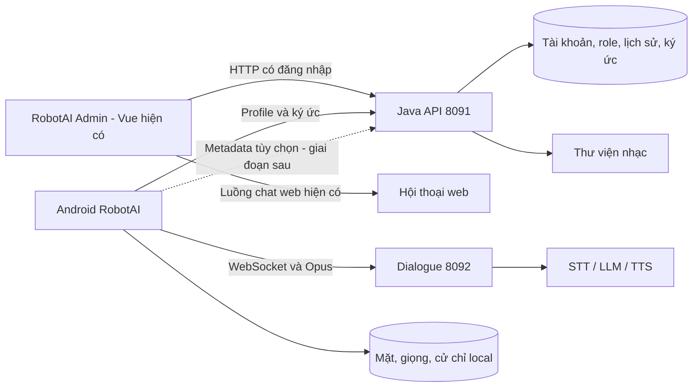

# Kế hoạch phát triển RobotAI Admin từ website Xiaozhi

Ngày lập: 12/10/2026. Cập nhật triển khai: mã nguồn MVP P0–P3 đã hoàn thành, build/kiểm thử tự động đã qua. Xem [báo cáo triển khai](ROBOTAI_ADMIN_WEB_IMPLEMENTATION_VI.md) để biết cấu hình chạy, kết quả đo và các bước nghiệm thu còn lại. P4/P5 vẫn là giai đoạn sau MVP.

## 1. Mục tiêu và phạm vi

Chỉnh sửa trực tiếp website tại `server-java/web` thành trang quản trị RobotAI. Giữ Vue 3, TypeScript, Vite, Ant Design Vue, Pinia, Vue Router, vue-i18n và backend Java hiện có. Tái sử dụng đăng nhập, phân quyền, danh sách, form, cấu hình provider và kiểm thử; bổ sung những luồng quản trị còn thiếu của RobotAI.

Giả định ban đầu: triển khai local/LAN với hai nhóm người dùng: người sở hữu tài khoản RobotAI và quản trị viên vận hành hệ thống. Chủ tài khoản quản lý nhân vật, hội thoại, ký ức của mình; quản trị viên quản lý tài khoản, provider và thư viện dùng chung. Quyền vận hành hệ thống không tự cấp quyền đọc ký ức riêng của tài khoản khác.

MVP gồm: giao diện tiếng Việt, nhận diện RobotAI, quản lý nhân vật/provider, **thay đổi cấu hình STT, TTS và LLM qua API bên thứ ba/cloud**, cấu hình nhân vật đang dùng trên Android, hội thoại và ký ức hiện có, thư viện nhạc và trạng thái dịch vụ. Quản lý người quen trên web cần thêm hợp đồng đồng bộ metadata với Android, thực hiện sau MVP.

## 2. Cơ sở đã khảo sát

| Thành phần có sẵn | Quyết định tái sử dụng |
|---|---|
| `web/src/layouts/MainLayout.vue`, `AppHeader.vue`, `AppSidebar.vue`, `AppFooter.vue` | Giữ bố cục, đổi thương hiệu và tổ chức menu theo công việc RobotAI. |
| `web/src/router/index.ts`, `routes.ts`, `guards.ts`, `composables/useMenu.ts` | Giữ cơ chế điều hướng/phân quyền, bổ sung route và permission cho tính năng mới. |
| `web/src/views/LoginView.vue`, `UserView.vue`, `AuthRoleView.vue`, `setting/AccountView.vue` | Giữ đăng nhập, tài khoản và phân quyền; Việt hóa giao diện. |
| `web/src/views/RoleView.vue`, `TemplateView.vue` | Mở rộng thành quản lý nhân vật: prompt, giọng, STT, LLM, công cụ và chọn nhân vật Android. |
| `web/src/views/DeviceView.vue` | Giữ quản lý/bind thiết bị; phân biệt thiết bị ảo tài khoản và phần cứng thật. |
| `web/src/views/config/{ModelConfigView,SttConfigView,TtsConfigView,AgentView,OssConfigView}.vue` | Giữ cấu hình; ưu tiên hiển thị provider dùng trong dự án, vẫn giữ lựa chọn nâng cao. |
| `web/src/views/MemoryManagementView.vue` | Giữ lọc thiết bị/nhân vật/thời gian, lịch sử, audio, tóm tắt; bổ sung sửa tóm tắt trong scope API hỗ trợ. |
| `web/src/views/ChatView.vue`, `services/chat.ts`, `services/conversation.ts` | Giữ hội thoại thử trên trình duyệt và lịch sử riêng của web. |
| `web/src/services/request.ts`, `api.ts`, `types/`, `composables/useRequest.ts`, `useTable.ts` | Tái sử dụng HTTP, xử lý lỗi, phân trang; không tạo client HTTP thứ hai. |
| `web/src/assets/theme.css`, `composables/useAntdTheme.ts` | Giữ theme và token Ant Design; điều chỉnh màu chủ đạo phù hợp Ken. |
| Vitest, Vue Test Utils, Playwright, kiểm thử Maven | Mở rộng kiểm thử hiện có theo từng luồng thực tế. |

Web hiện chỉ có locale `zh-CN` và `en-US`. Dashboard hiện dùng số đếm/lịch sử/thiết bị; chưa có API trạng thái đầy đủ cho gateway, PhoWhisper, Android hoặc motor.

## 3. Những ranh giới dữ liệu cần giữ đúng

1. **Thiết bị Android hiện tại:** backend profile dùng `user_chat_<userId>`, một định danh logic theo tài khoản; không phải ID duy nhất của từng điện thoại. Chưa có mô hình quản trị nhiều handset độc lập cho cùng một tài khoản.
2. **Hội thoại web và Android:** web dùng `/chat/open`, SSE và phiên web; Android dùng WebSocket dialogue. Hội thoại thử web không chứng minh microphone, Opus, MCP, wake hay loa Android hoạt động đúng, và không mặc định dùng chung conversation ID.
3. **Người quen:** tên, cách xưng hô, mẫu mặt/giọng và dữ liệu dạy cử chỉ nằm trong kho mã hóa local Android. Backend có ký ức theo person UUID nhưng chưa có API danh sách người quen đầy đủ để web truy vấn tên.
4. **Ký ức riêng:** API hiện tại tự xác định account và thiết bị ảo từ người đăng nhập, kiểm tra role thuộc account. Không thêm tham số userId tùy ý để đi vòng kiểm tra này.
5. **Cấu hình trên điện thoại:** công tắc biểu cảm/cử chỉ, ngưỡng nhận diện, mẫu tự học, nhắc việc và tọa độ thời tiết chưa có cơ chế đồng bộ web. MVP không hiển thị chúng như các thiết lập đã điều khiển được từ server.
6. **Nhạc:** đường RobotAI đang đọc MP3 và `catalog.json`; API upload Xiaozhi nhận MP3 hoặc `playlist.txt`. Hai định dạng không tự tương đương, cần adapter/hợp đồng catalog rõ ràng.
7. **Robot vật lý:** chế độ sạc Qi đã có; cổng motor/telemetry hiện mô phỏng. Web cần hiển thị nhãn mô phỏng, chưa có điều khiển ESP32 thật.

## 4. Cấu trúc giao diện đề xuất

| Khu vực | Luồng người dùng và phạm vi |
|---|---|
| Tổng quan | Các số đếm thật, nhân vật đang chọn, liên kết nhanh, trạng thái dịch vụ khi API mới sẵn sàng. |
| Robot và thiết bị | Thiết bị của tài khoản, nhân vật được gắn, trạng thái kết nối có nguồn dữ liệu rõ; thiết bị ảo không giả là điện thoại thật. |
| Nhân vật Ken | Tên, avatar, prompt/cách trả lời, STT/LLM/TTS, giọng/tốc độ/cao độ, công cụ; chọn dùng trên Android. |
| Cấu hình AI và giọng nói | Ba mục STT, TTS và LLM: tạo/sửa cấu hình API bên thứ ba hoặc local, kiểm tra, chọn cấu hình cho từng nhân vật theo quyền. |
| Hội thoại và ký ức | Lịch sử và tóm tắt; lọc theo scope. Trò chuyện thử trên web có chỉ dẫn rõ đây là luồng web. |
| Thư viện nhạc | Admin xem/thêm/sửa catalog, upload MP3, link YouTube, kiểm tra dữ liệu và nghe thử trên web. |
| Hệ thống | Provider, lưu trữ, trạng thái dịch vụ; tài khoản/phân quyền chỉ xuất hiện với quyền phù hợp. |
| Người quen - sau MVP | Danh sách metadata được đồng bộ, ký ức riêng; dữ liệu chưa đồng bộ được giải thích rõ. |

Giao diện giữ sidebar/header, bảng/form và dark/light mode hiện có. Màu nhấn cyan hoặc bạc hà được cấu hình bằng token Ant Design. Thuật ngữ thống nhất: “Nhân vật”, “Người quen”, “Ký ức”, “Nhận dạng giọng nói”, “Giọng trả lời”. Các màn chưa có capability/API sẽ không có nút lưu hoặc điều khiển giả.

### 4.1. Thay đổi cấu hình STT, TTS và LLM — yêu cầu bổ sung 12/10/2026

Cho phép cấu hình độc lập ba bước của hội thoại: **STT nhận dạng lời nói**, **LLM sinh câu trả lời**, **TTS tạo giọng trả lời**. Một nhân vật có thể dùng STT local, LLM cloud và TTS của một nhà cung cấp khác. Đưa tính năng này vào **P2/MVP**, không phụ thuộc đồng bộ người quen P4.

| Nhóm | Các trường và thao tác cần hỗ trợ |
|---|---|
| Chung | Tên cấu hình, provider, endpoint/base URL, thông tin xác thực theo provider (API key/token, app ID/secret nếu cần), model, bật/tắt và cấu hình mặc định. Tạo nhiều cấu hình, sửa, kiểm tra, lưu và chọn lại cấu hình trước. |
| STT | Chọn provider/model local hoặc cloud; ngôn ngữ tiếng Việt hoặc lựa chọn provider hỗ trợ; hotwords nếu có. Kiểm tra bằng file audio hoặc bản thu chủ động trên web, hiển thị bản chép lời, thời gian xử lý và lỗi. Nêu rõ provider trả final hay hỗ trợ partial; không coi chọn streaming là tự có phụ đề partial trên Android. |
| TTS | Chọn provider/model, giọng/voice ID, ngôn ngữ, tốc độ và cao độ khi provider hỗ trợ. Nhập câu thử tiếng Việt, tạo audio và nghe thử; hiển thị lỗi giọng/model không hợp lệ. Không hiển thị tham số không được adapter hỗ trợ như một thiết lập có hiệu lực. |
| LLM trả lời | Chọn provider/model, endpoint/base URL tùy chỉnh cho API tương thích, API key và tham số sinh câu trả lời như temperature/topP trong phạm vi model hỗ trợ. Dùng prompt nhân vật hiện có; gửi câu hỏi thử, hiển thị phản hồi và thời gian xử lý. |

**Tái sử dụng Xiaozhi:** mở rộng `web/src/views/config/SttConfigView.vue`, `TtsConfigView.vue`, `ModelConfigView.vue`, `components/ConfigManager.vue`, `config/providerConfig.ts` và `services/config.ts`. Gắn cấu hình với nhân vật qua `sttId`, `ttsId`, `modelId` và các trường giọng hiện có trong `RoleView`/form nhân vật.

**API bên thứ ba:** dùng các adapter provider hiện có trước. LLM bổ sung hoặc hoàn thiện lựa chọn API tương thích OpenAI với base URL/model tùy chỉnh. STT/TTS có giao thức HTTP, WebSocket, định dạng audio và xác thực khác nhau; provider mới phải có adapter và contract test tương ứng. Việc nhập endpoint/API key chưa đủ để hỗ trợ mọi dịch vụ cloud. Danh sách provider trên UI phải khớp backend, hiển thị rõ capability tiếng Việt, giọng, tham số, streaming, vision và tool calling nếu liên quan.

**Luồng thao tác:** chọn STT/TTS/LLM → chọn provider và nhập cấu hình → bấm Kiểm tra → xem kết quả → lưu cấu hình → chọn cấu hình cho nhân vật → lưu nhân vật. Phân biệt trạng thái “Đã lưu”, “Kiểm tra thành công/thất bại” và “Chờ phiên mới”; lưu cấu hình không đồng nghĩa model đã nạp hoặc phiên Android đã đổi.

**Áp dụng cấu hình:** lượt đang chạy giữ bộ STT/LLM/TTS đã chọn lúc bắt đầu phiên. Khi lưu/thay cấu hình, backend vô hiệu cache liên quan; phiên Android tiếp theo hoặc reconnect dùng cấu hình mới. Nếu worker local cần reload/restart để đổi model, hiển thị yêu cầu đó. Khi cấu hình mới lỗi, cho phép người dùng chọn lại cấu hình cũ; không tự chuyển giữa local/cloud hoặc sang provider khác khi chưa cấu hình rõ chính sách fallback.

**Quyền và credential:** người có quyền quản lý config tạo/sửa thông tin API; chủ nhân vật chọn trong các cấu hình được phép dùng. Credential lưu và sử dụng ở backend, không gửi xuống Android hoặc trả lại trong danh sách web, không đưa vào log hay bundle frontend. Sửa cấu hình không thay key nếu người dùng chưa nhập key mới. Endpoint tùy chỉnh cần kiểm tra scheme/host theo chính sách triển khai, cho phép địa chỉ local đã cấu hình và tránh gửi credential sang host redirect ngoài cấu hình.

**Kiểm tra trên web:** trước thao tác gửi audio/text thử, hiển thị provider đích và thông báo dữ liệu sẽ được gửi tới dịch vụ được chọn. Chỉ gọi khi người dùng bấm Kiểm tra/Nghe thử; không chạy inference có thể tính phí khi mở form hoặc kiểm tra trạng thái định kỳ.

## 5. Hợp đồng API

Giữ prefix và `ApiResponse` hiện có để tương thích Android/Xiaozhi. Chuẩn hóa cách dùng HTTP và lỗi cho phần bổ sung, không thay hàng loạt response cũ trong dự án này. Kiểm tra `VITE_API_BASE_URL` ở môi trường chạy: khi đã là `/api`, service dùng `/robot/...` hoặc `/user/...`, tránh `/api/api/...`.

| API backend hiện có | Cách dùng trong kế hoạch |
|---|---|
| `GET /api/user/robot-profile` | Lấy thiết bị ảo, danh sách role và role đang dùng của chính account. |
| `PUT /api/user/robot-profile/role` | Chọn nhân vật cho Android; thông báo thời điểm app đọc cấu hình, không hứa áp dụng nóng vào lượt đang nói. |
| `/api/role`, `/api/config`, `/api/device`, `/api/mcpTool/...` | Giữ CRUD/cấu hình/quyền công cụ hiện có. |
| `POST /api/config/test`; `GET /api/role/testVoice`; `GET /api/role/localStt` | Tái sử dụng kiểm tra config/nghe thử giọng/trạng thái STT local theo khả năng thực tế. Bổ sung contract cho audio test STT và các capability còn thiếu; không giả định các API hiện tại đã bao phủ mọi provider cloud. |
| `/api/message`, `/api/memory/summary` | Giữ lịch sử/tóm tắt theo kiểm tra quyền và scope hiện có. |
| `GET /api/robot/memories`; `PUT/DELETE /api/robot/memories/{roleId}/{id}` | Xem/sửa/xóa tóm tắt cho thiết bị ảo của chính account. API sửa này chưa tổng quát cho mọi thiết bị. |
| `/api/robot/people/{personId}/memory?roleId=...` | CRUD/bật tắt ký ức riêng khi đã có person UUID hợp lệ; không cung cấp sẵn danh sách tên người quen. |
| `DELETE /api/robot/people/{personId}` | Hiện xóa/tắt ký ức backend; chưa tự xóa hồ sơ/mặt/giọng trên Android. UI phải mô tả đúng hiệu lực. |
| `POST /api/file/music`; `GET /api/robot/music/audio?name=...` | Tái sử dụng có kiểm tra định dạng/quyền; bổ sung quản lý catalog còn thiếu. |

API bổ sung cho trạng thái dịch vụ, catalog nhạc và thử STT/TTS đã triển khai; contract tại `server-java/contracts/robotai-admin.openapi.yaml`. Danh sách người quen từ metadata đồng bộ vẫn thuộc P4, chưa triển khai. Scope với Android phải được kiểm tra ở cả provider và consumer.

ID Long được giữ dưới dạng chuỗi khi truyền tới JavaScript; không parse summary ID thành number. Revision ký ức và timestamp đo trạng thái cần semantics rõ. API mới tuân theo Controller → service/port → persistence; không trả entity hoặc record service trực tiếp nếu vi phạm kiến trúc DTO của dự án.

## 6. Thứ tự triển khai

### P0 — Xác lập baseline và hợp đồng (độ phức tạp trung bình)

- Kiểm tra trạng thái Git và giữ nguyên các thay đổi Android/backend đang có; xác định phạm vi file của từng thay đổi quản trị.
- Chạy kiểm tra web hiện có và ghi baseline thực tế; báo lỗi cũ riêng, không lấy báo cáo 04/10 làm kết quả hiện tại.
- Kiểm tra owner/permission của các luồng sẽ dùng; xác minh profile, virtual device và API base ở môi trường dev/build.
- Viết OpenAPI cho API bổ sung, thống nhất scope và trạng thái capability; tái sử dụng `types/`/DTO cho API cũ.
- File chính: `web/src/services/api.ts`, `request.ts`, `types/`, router; contract mới và Controller liên quan.
- **Hoàn tất khi:** inventory, API hiện có/đề xuất, baseline và các trường hợp quyền được ghi rõ. Phụ thuộc: không có. Rủi ro: nhầm scope hoặc làm ảnh hưởng code chưa commit.

### P1 — Thương hiệu RobotAI, tiếng Việt và điều hướng (trung bình)

- Đổi tên ứng dụng, logo/favicon, tiêu đề và nội dung giới thiệu; giữ credit/license upstream.
- Thêm `web/src/locales/vi-VN.ts`; cập nhật `locales/index.ts`, `useLocale.ts`, bộ chọn locale và locale Ant Design/dayjs. Ưu tiên tiếng Việt khi chưa chọn ngôn ngữ.
- Cập nhật route/menu theo nhóm ở mục 4; giữ deep link cũ hoặc redirect tương thích và quyền truy cập tương ứng.
- Tái sử dụng `MainLayout`, header/sidebar, theme token; xử lý loading, lỗi, rỗng, keyboard và màn hình hẹp.
- File chính: `web/index.html`, assets, `src/layouts/`, `src/router/`, `src/locales/`, `src/composables/useAntdTheme.ts`.
- **Hoàn tất khi:** đăng nhập, menu và các màn MVP hiển thị tiếng Việt đúng; quyền/điều hướng/dark-light hoạt động. Phụ thuộc: P0. Rủi ro: thiếu translation key hoặc làm thay đổi route permission.

### P2 — Khép kín nhân vật, Android profile và ký ức (trung bình đến cao)

- Mở rộng `RoleView.vue` và form hiện có, đặt PhoWhisper/Codex/provider TTS dự án vào luồng cấu hình dễ tìm; không tạo bản sao form STT/TTS/LLM.
- Triển khai mục 4.1: cấu hình API bên thứ ba/cloud cho **cả STT, TTS và LLM**; endpoint, credential, model/giọng, kiểm tra/ nghe thử và chọn độc lập theo nhân vật. Giữ tùy chọn local. Kiểm tra adapter thực tế và bổ sung adapter thiếu trước khi đưa provider vào UI.
- Kiểm tra cache invalidation và thời điểm áp dụng khi sửa endpoint/key/model hoặc đổi `sttId`/`ttsId`/`modelId`; thông báo phiên mới/reconnect và cho chọn lại cấu hình trước nếu lỗi.
- Bổ sung service `robotProfile.ts` và thao tác “Dùng trên Android” qua API profile; giữ phân biệt role nhân vật và auth-role phân quyền.
- Điều chỉnh `DeviceView.vue` để hiển thị virtual device đúng; deep link hội thoại/ký ức giữ deviceId và roleId đã chọn, kể cả khi danh sách đang phân trang.
- Mở rộng `MemoryManagementView.vue` để sửa tóm tắt trong scope API RobotAI hỗ trợ; giữ xem/xóa theo thiết bị khác bằng API cũ khi có quyền. Tách rõ xóa tóm tắt, xóa lịch sử và xóa ký ức riêng.
- `ChatView.vue` giữ luồng chat web; cung cấp đường thử nhân vật và kiểm tra riêng trên app Android.
- File chính: `web/src/views/RoleView.vue`, `DeviceView.vue`, `MemoryManagementView.vue`, `ChatView.vue`, `views/config/{SttConfigView,TtsConfigView,ModelConfigView}.vue`, `components/ConfigManager.vue`, `config/providerConfig.ts`, `services/config.ts`, `services/robotProfile.ts`, `services/robotMemory.ts`, `types/`; backend `xiaozhi-ai/src/main/java/com/xiaozhi/ai/stt/SttServiceFactory.java`, `tts/TtsServiceFactory.java`, `llm/factory/ChatModelFactory.java` và adapter liên quan.
- **Hoàn tất khi:** lưu/chọn cấu hình STT/TTS/LLM bên thứ ba độc lập cho role, kiểm tra và nghe thử đúng provider; key sai/endpoint lỗi/model không hỗ trợ báo đúng; phiên mới dùng cấu hình mới và có thể chọn lại cấu hình trước. Account thử tạo/sửa role → chọn cho Android → app đọc đúng profile ở lần refresh/reconnect; sửa/xóa tóm tắt đúng scope; account khác bị từ chối. Phụ thuộc: P1. Rủi ro: đổi cấu hình giữa phiên, adapter cloud chưa tương thích, cache cũ, ID lớn, request cũ ghi vào role mới.

### P3 — Nhạc và trạng thái vận hành; hoàn thành MVP (cao)

- Thêm `MusicLibraryView.vue`: danh sách, tên bài/ca sĩ, upload MP3, link YouTube, chỉnh/xóa catalog; báo file/link lỗi. Web nghe thử là playback trình duyệt; nút phát lên điện thoại chỉ có sau khi thiết kế transport và xác nhận capability.
- Chuẩn hóa catalog dùng chung giữa API quản trị và dialogue; ghi file nguyên tử/kiểm revision để tránh ghi đè. Thư viện dùng chung hiện tại dành cho admin; thư viện riêng account là hạng mục khác.
- Thêm API trạng thái backend/worker với địa chỉ cấu hình cố định, timeout và quyền; trả `healthy/degraded/unavailable/unknown` cùng `checkedTime` (tên theo quy tắc kiến trúc dự án). Trạng thái này không tự chứng minh toàn pipeline voice khỏe.
- Dashboard chỉ hiển thị latency/lỗi khi có collector thật và cửa sổ đo; chưa có dữ liệu hiển thị “Chưa có số đo”. Không suy diễn điện thoại online từ database có thiết bị.
- File mới dự kiến: `web/src/views/MusicLibraryView.vue`, `SystemStatusView.vue`, `services/musicLibrary.ts`, `systemStatus.ts`; controller/service/DTO mới ở module Java phù hợp.
- **Hoàn tất khi:** catalog được dialogue đọc đúng, file lỗi/quyền sai bị từ chối; dịch vụ tắt được hiển thị đúng; các luồng P1–P3 đạt kiểm thử và kiểm tra tích hợp. Phụ thuộc: P0 contract và P2. Rủi ro: format nhạc cũ, path traversal, phép đo gây tải hoặc báo khỏe sai.

### P4 — Người quen và ký ức riêng trên web (cao, sau MVP)

- Android là nguồn tạo person UUID/mẫu nhận diện. Bổ sung đồng bộ metadata tùy chọn: UUID, tên/cách xưng hô, trạng thái đăng ký, version và thời điểm đồng bộ. Mặt/giọng/crop/cử chỉ không nằm trong payload metadata.
- Thiết kế danh sách backend có owner và liên kết role; web dùng danh sách đó để truy cập API ký ức riêng hiện có. Trước khi có metadata, không suy ra tên từ nội dung chat hoặc tự tạo profile thay Android.
- Giai đoạn đầu web chỉ xem metadata và sửa ký ức. Đổi tên/xóa profile local cần cơ chế revision, tombstone và acknowledgement từ Android; phân biệt “đã yêu cầu” với “đã áp dụng”, xử lý điện thoại offline và request cũ.
- Nếu mở rộng nhiều điện thoại, giải quyết device identity trước; không dùng `user_chat_<userId>` như một ID handset.
- File chính: `android-app/robot-app/app/src/main/java/com/robotai/robot/identity/PeopleStore.kt`, `IdentityController.kt`; Controller/service/DTO/migration mới ở `server-java`; `web/src/views/PeopleView.vue`, `services/people.ts`, component ký ức riêng.
- **Hoàn tất khi:** đúng owner, giữ UUID, metadata đồng bộ có timestamp; account khác không truy cập được; sửa/xóa/tắt ký ức tôn trọng revision; không có mẫu sinh trắc học trong API/log. Phụ thuộc: P2 và contract Android–backend. Rủi ro: đồng bộ/xóa chưa xác nhận, nhầm người hoặc nhầm scope.

### P5 — Thiết lập app, cử chỉ, chẩn đoán thiết bị (hạng mục riêng)

Sau khi có channel đồng bộ cấu hình được xác nhận bởi điện thoại, mới bổ sung quản trị công tắc/thiết lập app và metadata model cử chỉ. Vẫn thu mẫu/dạy cử chỉ trên Android. Không cho web bật active-speaker/barge-in khi chưa có readiness hợp lệ. Voice cloning local theo kế hoạch riêng; điều khiển ESP32 theo transport phần cứng được nghiệm thu riêng.

## 7. Phân quyền và tương thích

- Giữ auth-role/permission tree Xiaozhi; thêm quyền thao tác cụ thể cho catalog/status/metadata, kèm kiểm tra server. Ẩn menu chỉ là lớp giao diện.
- Kiểm tra owner cho account, role, device, person và ký ức; bổ sung regression account A/B. Admin hệ thống không tự vượt scope owner-only API RobotAI.
- `ConfigResp` hiện không trả apiKey/apiSecret; giữ cơ chế nhập/thay thế credential, không thiết kế nút đọc lại secret từ list API. Giá trị che không được ghi đè credential thật khi lưu. `/config/test` có thể gọi dịch vụ thật, nên kiểm thử phát triển dùng mock/probe thử.
- Migration mới phải chọn version chưa dùng, không sửa lại migration V89 đã tồn tại. Thay đổi thêm vào phải để Android/client cũ tiếp tục hoạt động.
- Kiểm tra upload theo nội dung/giới hạn/đường dẫn; quyền catalog toàn hệ thống và quyền dữ liệu riêng được tách rõ.
- Giữ reverse proxy `/api`, `/ws`, audio/upload; kiểm tra cả dev Vite và bản build/nginx. Không đưa credential backend vào biến `VITE_*` public.

## 8. Kiểm thử và tiêu chí nghiệm thu

1. **Web:** `npm run build`, `npm run lint`, `npm run test:run`, `npm run test:coverage`, `npm run test:e2e` trong `server-java/web`, bằng runtime thỏa engines hiện có. Build đã bao gồm vue-tsc; chỉ chạy thêm type-check riêng khi cần chẩn đoán.
2. **Backend:** kiểm thử controller/service/ownership/serialization và migration trên database thử riêng. Chạy kiểm tra module bị thay đổi cùng dependencies; toàn reactor trước phát hành. Dùng JDK/Maven settings của dự án.
3. **E2E nghiệp vụ:** đăng nhập/restore/hết hạn token; thay locale; tạo/sửa/chọn role; filter phân trang/deep link; sửa/xóa ký ức; nhạc hợp lệ/lỗi; mất backend; account A/B và quyền bị thu hồi. Dùng dữ liệu/tài khoản thử, không xóa dữ liệu người dùng.
4. **Contract:** fixture frontend và response backend phải khớp artifact; kiểm ID lớn, null/empty, lỗi, enum mới và response tới chậm sau đổi role/account.
5. **Android tích hợp:** profile mới được đọc đúng, hội thoại sau reconnect, nhạc MCP theo luồng thật; metadata P4 cần regression UUID/revision/deletion. Test web không thay thế nghiệm thu native.
6. **UI:** tiếng Việt không tràn/còn raw key, responsive, keyboard/focus, tương phản, dark/light, loading/empty/error/retry, không đặt nút điều khiển cho tính năng chưa hỗ trợ.
7. **Cấu hình STT/TTS/LLM:** kiểm tra tạo/sửa/chọn từng loại, kết hợp local/cloud khác provider, giữ key cũ khi không thay key, không lộ credential, sai key, timeout, rate limit/quota và model/giọng không tồn tại. Đổi provider phải loại cache cũ và áp dụng ở phiên mới; lượt đang chạy không trộn provider. STT test audio và TTS nghe thử chạy qua adapter đúng; kiểm capability tiếng Việt/tham số. Unit/contract test dùng mock; live test với API bên thứ ba và Android thực được ghi nhận riêng, gồm chọn lại cấu hình cũ khi cấu hình mới lỗi.

Mục tiêu coverage tối thiểu 80% cho logic mới quan trọng theo ECC; báo coverage thực tế và thiếu sót, không tuyên bố toàn repository đạt khi chưa đo. Mỗi mốc có báo cáo PASS/FAIL, test bỏ qua và nguyên nhân, screenshot/trace lỗi khi phù hợp. Không gọi inference thật trong unit test hoặc health polling; bài live chạy riêng có chủ đích.

## 9. Áp dụng ECC đã cài trong dự án

Nguồn chính là `server-java/.agents/`; thư mục bị Git bỏ qua nên cần tìm bằng `rg --hidden --no-ignore` có loại trừ node_modules/target. Không cài lại hay thay hooks/config ECC trong hạng mục này.

| ECC đã đọc | Cách dùng |
|---|---|
| `.agents/skills/ecc-guide/SKILL.md` | Chọn workflow theo các file local thực tế. |
| `.agents/agents/planner.md` | Chia mốc, chỉ rõ file, phụ thuộc, rủi ro và đầu ra kiểm chứng của kế hoạch này. |
| `.agents/skills/vue-patterns/SKILL.md` | Giữ Composition API/Pinia/composables, lifecycle cleanup và lazy route; không đổi stack. |
| `.agents/skills/contract-first/SKILL.md` | Đặc tả chung trước khi thêm boundary web/Java/Android; kiểm response thực và consumer. |
| `.agents/skills/api-design/SKILL.md` | Resource, DTO, ID, phân trang, validation, ownership và tương thích cho API bổ sung. |
| `.agents/skills/verification-loop/SKILL.md` | Quy trình build/type/lint/test/kiểm credential/diff khi triển khai từng mốc. |
| `.agents/skills/e2e-testing/SKILL.md` | Tổ chức kiểm thử hành trình, fixture độc lập, chờ điều kiện thực và lưu bằng chứng lỗi. |

`i18n-sync` local giới hạn ở JSON locale, còn web dùng TypeScript; phần Việt hóa dùng vue-i18n và locale-parity test hiện có. `plan-canvas` đã được khảo sát nhưng không kích hoạt phiên review browser trong lượt lập kế hoạch này; kế hoạch mở bằng trình đọc file Codex. `inherit-legacy-style` chưa kích hoạt quy trình tạo hook/rules riêng; conventions hiện có được ghi trong inventory và kế hoạch.

## 10. Đầu ra và điểm bắt đầu

- Sau P1: giao diện quản trị RobotAI tiếng Việt dùng được trên nền Xiaozhi.
- Sau P2: đổi cấu hình STT/TTS/LLM local hoặc API bên thứ ba/cloud cho từng nhân vật, kiểm tra/nghe thử và áp dụng ở phiên Android mới; quản lý hội thoại/ký ức theo scope hiện tại.
- Sau P3: MVP quản trị có nhạc và trạng thái dịch vụ, cùng kiểm thử tích hợp.
- Sau P4: quản lý metadata người quen và ký ức riêng với đồng bộ Android rõ ràng.

Mã nguồn P0–P3 và báo cáo kiểm thử được cập nhật ngày 12/10/2026. Backend/web bản mới đã khởi chạy local để người dùng kiểm tra, V90 đã áp dụng thành công trên schema `robotai_ken`. Chưa chạy migration guard trên MySQL rỗng riêng hoặc nghiệm thu đầy đủ API cloud/Android thật. Các giới hạn này được ghi trong báo cáo triển khai; không coi kiểm thử giả lập hoặc khởi chạy dịch vụ là nghiệm thu native. P4/P5 giữ phạm vi và phụ thuộc như trên.
