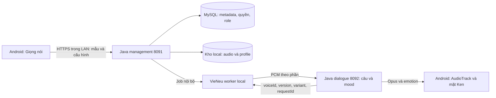

# Kế hoạch giọng nói cá nhân cho RobotAI

Ngày: 09/10/2026. Trạng thái: kế hoạch và bản thiết kế giao diện; chưa triển khai tính năng.

## 1. Mục tiêu và yêu cầu đã xác nhận

Ken trả lời bằng giọng của chủ robot, giữ phát âm tiếng Việt tự nhiên và có cách nói phù hợp với tình huống. Người dùng có một màn hình **Giọng nói** trong app Android để tạo, nghe thử, chọn và quản lý giọng.

**Ràng buộc do người dùng xác nhận:** chạy local, không gửi mẫu giọng ra dịch vụ ngoài. Thu âm, làm sạch, tạo hồ sơ clone, tổng hợp, nghe thử và lưu trữ đều trên điện thoại hoặc backend do người dùng kiểm soát. API quản trị dùng trong LAN; worker TTS chỉ truy cập nội bộ. Không tự chuyển sang TTS cloud khi lỗi.

Local ở đây áp dụng toàn bộ tính năng giọng clone. LLM gateway hiện tại dùng Codex; hội thoại toàn hệ thống chỉ được gọi là offline hoàn toàn nếu LLM cũng được chuyển sang mô hình local trong một hạng mục riêng.

Phạm vi đầu tiên: một tài khoản, robot Ken, một giọng cá nhân đang dùng cho mỗi role. Thư viện giọng thuộc tài khoản; role tham chiếu giọng đã chọn. Các thiết bị dùng cùng role sẽ nhận cùng cấu hình, phải thể hiện rõ khi bấm áp dụng.

## 2. Những gì đã có và cần bổ sung

Nhận định từ source local, không phải xác nhận runtime trong lần lập kế hoạch này:

| Hiện có | Điểm tích hợp |
|---|---|
| Android Compose, `CompanionScreen`, chọn role, `RobotViewModel`, mic, Opus và AudioTrack | Thêm tab Giọng nói và flow cấu hình riêng |
| `TtsService.textToSpeech()` trả `Path`; factory chưa có VieNeu | Thêm adapter local và port PCM streaming bên cạnh port file |
| `SynthesizerFactory` luôn tạo `FileSynthesizer` | Chọn synthesizer streaming theo capability |
| `SentenceHelper` tạo `SentenceResult` có mood | Mang mood qua bước điều phối cách nói, không chỉ hiển thị |
| `ScheduledPlayer` gửi emotion; thiếu mood có thể chọn emotion ngẫu nhiên | Với provider mới, dùng mood xác định hoặc neutral để mặt và giọng đồng bộ |
| Role đã có `ttsId`, `voiceName`, `ttsSpeed`, `ttsPitch` | Thêm tham chiếu profile có kiểm quyền, version và chế độ biểu đạt |
| VieNeu SDK 3.8.3 và mẫu v3 Turbo tại `android-app/.work` | Tận dụng để thử nghiệm; pin revision/hash, không mặc định nâng SDK |
| Bộ mẫu đã tải backbone và codec decoder | Kiểm kê/tải thêm encoder, speaker encoder và denoiser cần cho cloning trước khi chạy offline |
| CAM++ nhận diện người nói ở tab Người quen | Đây là dữ liệu nhận dạng, không dùng thay hồ sơ giọng tổng hợp |

Xem [kiến trúc giọng trên backend](SERVER_VOICE_ARCHITECTURE_VI.md), [bộ mẫu VieNeu](VIENEU_TTS_TRIAL_VI.md) và [app robot](../android-app/robot-app/README.md). Quyết định chuyển STT/TTS lên backend trong tài liệu kiến trúc mới hơn là hướng hiện hành.

## 3. Chọn công nghệ và giới hạn ngữ điệu

**Ứng viên ưu tiên: VieNeu-TTS v3 Turbo chạy trên backend local.** Upstream mô tả cloning từ clip 3–8 giây, lưu/tái sử dụng hồ sơ giọng và PCM streaming. Đây là năng lực công bố, cần kiểm chứng trên revision và máy của dự án. [Nguồn upstream](https://github.com/pnnbao97/VieNeu-TTS#voice-cloning).

Bản đầu dùng reference-based cloning: trích speaker embedding và reference codes một lần, tái sử dụng cho các câu mới. Chưa cần train lại trọng số. Fine-tuning/LoRA là bước nâng chất lượng sau khi nghe thử cho thấy cloning bằng mẫu chưa đủ; cần đánh giá dataset, GPU và checkpoint phù hợp trước khi quyết định.

**Không coi v3 Turbo là mô hình nhận mọi chỉ dẫn cảm xúc.** Upstream và source local ghi `style` đã deprecated và bị bỏ qua; cách đọc chịu ảnh hưởng bản thu tham chiếu. Các cue `[cười]`, `[thở dài]`, `[hắng giọng]` là thử nghiệm, không tương đương khả năng tùy ý điều khiển vui/buồn. [Nguồn](https://github.com/pnnbao97/VieNeu-TTS#reading-style--deprecated-).

Ngữ điệu triển khai theo mức:

1. **MVP:** giọng tự nhiên từ mẫu trung tính, giữ dấu câu và ngắt nghỉ, phát câu đủ nghĩa. Emotion UI dùng cùng mood đã chuẩn hóa, neutral nếu thiếu.
2. **Thử nghiệm:** cùng một người có các mẫu tự nhiên/vui/nhẹ nhàng. Backend chọn biến thể tham chiếu theo `neutral`, `happy`, `caring`, `serious`. Chỉ bật khi thử nghe chứng minh vẫn giống cùng người và không đổi giọng bất thường giữa các câu. Thiếu biến thể dùng neutral.
3. **Nâng cao:** so sánh một mô hình local khác hoặc fine-tuning nếu biểu đạt còn yếu. Chọn dựa trên thử nghe và benchmark, không hứa rằng thêm tham số `emotion` sẽ đủ.

UI lấy capabilities từ backend. Tốc độ, cao độ, mức biểu cảm chỉ xuất hiện khi adapter thực sự hỗ trợ và đã kiểm chứng; không tạo thanh trượt chỉ để có hình thức.

## 4. Màn hình Giọng nói trong Android

Vị trí: thêm tab **Giọng nói** vào giao diện thường của `CompanionScreen`. Chế độ đế có lối tắt mở cấu hình; thu mẫu chỉ thực hiện trong giao diện cấu hình khi app foreground.

Ba phần trên cùng một màn hình:

| Phần | Nội dung và thao tác |
|---|---|
| **Cấu hình** | Ken/role đang chọn, giọng đang dùng, trạng thái engine local, chọn giọng cá nhân hoặc preset local, chế độ Tự nhiên / Theo ngữ cảnh (thử nghiệm), âm lượng phát local, Lưu cho Ken |
| **Tạo giọng** | Đặt tên, hướng dẫn thu, xác nhận dùng giọng của mình, thu trực tiếp hoặc nhập WAV, nghe lại, kiểm chất lượng, tạo hồ sơ, trạng thái xử lý và lỗi có thể thử lại |
| **Thư viện** | Preset và giọng cá nhân, tên/trạng thái/ngày tạo, nghe thử, chọn, đổi tên, xóa; thông báo các role bị ảnh hưởng khi xóa |

Khối **Nghe thử** nằm ngay dưới cấu hình: câu tự nhập và bốn mẫu Chào hỏi / An ủi / Cảnh báo / Đọc số. Nghe thử dùng cấu hình nháp, chưa thay giọng đang dùng. Khi thử với biến thể cảm xúc, hiển thị cách nói thực tế và việc dùng neutral nếu thiếu mẫu.

Khung màn hình chính:

```text
Giọng nói                                      Ken
Xử lý trên máy chủ của bạn · Động cơ đã sẵn sàng

[ Cấu hình ] [ Tạo giọng ] [ Thư viện ]

Giọng dùng cho Ken
  Giọng của tôi                 [Chọn giọng ▾]
  [Tạo giọng mới]

Cách nói
  ● Tự nhiên   ○ Theo ngữ cảnh (thử nghiệm)
  Âm lượng loa: ━━━━━●━━

Nghe thử
  [Chào hỏi] [An ủi] [Cảnh báo] [Đọc số]
  “Chào bạn, mình là Ken. Hôm nay bạn thế nào?”
  [Nghe thử]  [Dừng]

[Lưu cho Ken]
```

Trạng thái giao diện phải có: chưa có mẫu, thiếu model cloning, mất backend, đang thu, đang kiểm tra, đang tạo, đã sẵn sàng, lỗi, đang nghe thử, thay đổi chưa lưu. Dùng nhãn “Đang tạo giọng” cho reference cloning; chỉ dùng “Đang huấn luyện” khi thực sự fine-tuning.

`VOICE_SETTINGS_PREVIEW.html` là bản thiết kế tương tác có dữ liệu minh họa; không kết nối robot hay xử lý giọng thật.

## 5. Luồng tạo giọng

1. Chọn Tạo giọng, đặt tên và xác nhận mẫu là giọng của mình. UI giải thích mẫu được xử lý trên backend local và cho lựa chọn giữ/xóa bản thu gốc sau khi tạo.
2. Tạm dừng mic hội thoại, wake-word, phát nhạc và TTS trước khi dùng micro. Tái sử dụng nguyên tắc exclusive mic của voice enrollment hiện có, nhưng lưu dữ liệu cloning riêng.
3. Thu 20–30 giây nói tự nhiên hoặc nhập WAV. Đây là dữ liệu để chọn một đoạn tốt; không đưa nguyên bản dài vào encoder rồi mặc định mọi phần đều được học.
4. Dùng recorder cho mẫu sạch, ưu tiên PCM mono 44,1/48 kHz nếu thiết bị hỗ trợ; có fallback 16 kHz được báo rõ và được thử chất lượng. Không thu qua Opus VOIP rồi giải mã lại để làm nguồn clone. Chuẩn hóa theo encoder của revision đã pin trên worker.
5. Kiểm tra im lặng, thời lượng lời nói, clipping, mức tín hiệu/tạp âm; chọn đoạn 3–8 giây có câu trọn ý, cho nghe lại/cắt lại. Ngưỡng được hiệu chỉnh bằng dữ liệu thử; kiểm tra này không đảm bảo phát hiện mọi trường hợp có nhiều người nói.
6. Chỉ khi bấm Tạo giọng mới gửi mẫu tới backend local đã cấu hình. API multipart có giới hạn 20 MB và thời lượng giải mã 60 giây ban đầu; kiểm format thật sau giải mã và giới hạn tài nguyên.
7. Worker làm sạch nếu cần, trích profile một lần, lưu profile có owner và version; tạo câu kiểm tra mới. Hồ sơ chỉ READY sau khi engine nạp lại và tổng hợp thành công.
8. Người dùng nghe thử trên điện thoại, chọn Dùng cho Ken. Khôi phục vòng nghe trước đó khi rời flow, sau khi audio preview đã dừng. Hủy/đưa app vào nền/logout phải dừng thu và đóng file tạm.

Biến thể vui/nhẹ nhàng là tùy chọn sau MVP: thu đoạn riêng cho từng cách nói, có nghe thử so sánh. Không suy ra cảm xúc chỉ từ việc đổi tốc độ hoặc cao độ.

## 6. Kiến trúc tích hợp



Worker đề xuất tại `services/vieneu/`, thêm start/status/stop/health vào `backend.py`. Giữ engine nạp sẵn, warmup, ban đầu một request tổng hợp và hàng đợi có giới hạn. Tạo profile chạy ở queue riêng có ưu tiên thấp hơn hội thoại; chưa hứa concurrency từ benchmark upstream.

**Hai bước phát audio:** dùng adapter trả WAV theo câu để kiểm chức năng và đối chiếu trước; sau đó thêm `StreamingTtsService`/`StreamingSynthesizer` phát PCM ngay khi worker có chunk. Không gọi việc chia file WAV đã hoàn tất là inference streaming.

PCM của v3 Turbo là 48 kHz theo upstream. Java resample stateful về sample rate đã thương lượng, mã hóa Opus qua player hiện có; không đổi sample rate giữa câu, không tạo WAV header cho mỗi chunk. Có backpressure và thứ tự câu; hủy request, bỏ chunk đến muộn và xóa buffer client khi abort. Kiểm tra guard thực tế hiện có trước khi mở rộng giao thức; contract P2 là thiết kế, không chứng minh mọi extension đã chạy.

Đóng băng cấu hình và profile version ở đầu lượt. Bấm Lưu có hiệu lực ở lượt sau, không đổi giọng giữa câu. Management phát sự kiện invalidation nội bộ cho dialogue; việc lưu nháp không tự ngắt phiên hiện tại.

Fallback: preset local đã cài và đạt health check. Nếu không có preset local, báo lỗi âm thanh và vẫn hiển thị câu trả lời. **Sửa nhánh default Edge trong `TtsServiceFactory` để provider local mới, thiếu cấu hình hoặc worker lỗi không tự đi ra cloud.** Khi profile mới lỗi, giữ profile đã dùng trước đó nếu còn hợp lệ.

## 7. Dữ liệu và API dự kiến

Tên bảng/endpoint dưới đây là đề xuất để triển khai, chưa có trong hệ thống.

| Dữ liệu | Nội dung |
|---|---|
| `robot_voice_profile` | UUID, owner userId, tên, engine/model revision, status, version, đường dẫn nội bộ, retention, timestamps |
| `robot_voice_variant` | Profile/version, variant, reference codes và speaker embedding hoặc artifact path, quality metadata |
| `robot_voice_job` | JobId, owner, trạng thái, tiến độ theo bước, lỗi, deadline, idempotency key |
| `robot_role_voice` | roleId, profileId, speechMode, fallback presetId, version; role ownership bắt buộc |

Profile artifact dùng khóa namespace owner/profile/version; không dùng tên do người dùng nhập làm tên file hoặc tên giọng toàn cục trong SDK. Không trả đường dẫn filesystem trong API. Dữ liệu mã hóa trên ổ lưu trữ và bị loại khỏi Git, telemetry, log nội dung, public upload và đồng bộ/backup cloud tự động. Hồ sơ embedding/codes cũng được bảo vệ như bản thu. Lựa chọn xóa bản gốc vẫn giữ artifact cần cho tổng hợp; xóa giọng phải xóa cả artifact và cache, xử lý các role đang tham chiếu.

| API | Chức năng |
|---|---|
| `GET /api/robot/voices/capabilities` | Engine sẵn sàng, model revision, limits, cloning/streaming/variant/rate capabilities |
| `GET /api/robot/voices` | Preset local và profile thuộc tài khoản |
| `POST /api/robot/voices` | Multipart mẫu + tên + consent + retention; trả 202, profileId và jobId |
| `GET /api/robot/voices/jobs/{jobId}` | Poll khi job còn chạy, backoff; dừng khi terminal hoặc rời màn hình |
| `POST /api/robot/voices/{id}/preview` | Câu ngắn + cấu hình nháp; trả PCM stream đã xác thực hoặc audio local có hạn dùng |
| `PATCH /api/robot/voices/{id}` | Đổi tên, cập nhật retention |
| `DELETE /api/robot/voices/{id}` | Thu hồi quyền dùng, đổi các role liên quan sang preset local và dọn artifact/cache |
| `GET/PUT /api/robot/roles/{roleId}/voice` | Đọc/lưu binding, kiểm READY + ownership + version để tránh ghi đè nhầm |

Endpoint nhận/chạy variant thêm ở giai đoạn biểu đạt. Session auth hiện có; owner lấy từ phiên đăng nhập, không tin userId trong request. Preview giới hạn ký tự, queue và deadline; hủy khi nhấn Dừng. Tất cả đường phục vụ audio kiểm quyền, không dùng URL upload công khai.

Job trạng thái: `QUEUED → VALIDATING → EXTRACTING → VERIFYING → READY`; có `FAILED`/`CANCELLED`. Khởi động lại phải đưa job dang dở về trạng thái có thể thử lại; profile/version cũ không bị ghi đè từng phần. Hoàn tất artifact trước khi commit READY, hủy/xóa có tombstone để chặn job muộn hồi sinh profile.

## 8. Lộ trình và tiêu chí nghiệm thu

Ước lượng sơ bộ **8–12 ngày công**, phụ thuộc clone trên CPU hiện tại và chất lượng mẫu; không phải cam kết thời gian. Có thể dừng sau MVP để đánh giá nghe trước khi mở rộng biểu đạt.

| Bước | Công việc | Điều kiện xong |
|---|---|---|
| 1 · 1–2 ngày | Kiểm kê model, pin SDK, bổ sung artifact cloning, kiểm không egress; benchmark mẫu của chủ robot | Tạo profile và đọc 10–20 câu mới hoàn toàn local; có số đo và chủ robot đánh giá độ giống |
| 2 · 2 ngày | Worker, storage, ownership, job và preview; adapter WAV để đối chiếu | Profile tồn tại qua restart, hủy/xóa đúng, account khác không truy cập được |
| 3 · 2–3 ngày | Tab Giọng nói, recorder/import, quality, nghe thử, chọn/lưu | Flow từ thu mẫu đến dùng cho Ken chạy trên điện thoại thật; không tranh micro với hội thoại/nhạc |
| 4 · 2–3 ngày | Binding role/version, PCM streaming, cancel và fallback local | Hội thoại thật dùng giọng đã lưu; câu đúng thứ tự, không phát audio cũ sau abort, worker lỗi không dùng cloud |
| 5 · 1–2 ngày | Thử biến thể ngữ cảnh và đồng bộ mặt/giọng | Nghe thử chào/an ủi/cảnh báo; chỉ bật feature khi identity ổn định và cách nói phù hợp |

Nghiệm thu cần bao gồm:

- **Chất lượng:** chủ robot nghe câu chưa có trong mẫu, chấm độ giống/phát âm/tự nhiên trên thang 1–5. Mục tiêu ban đầu trung bình từ 4/5 trên 20 câu; đây là tiêu chí đề xuất, không bảo đảm của model. Thử tên riêng, số, dấu thanh, câu hỏi và thuật ngữ Anh–Việt.
- **Độ trễ:** đo từ câu hoàn chỉnh vào TTS đến mẫu PCM có lời đầu tiên thực sự phát; đo riêng toàn lượt từ kết thúc nói đến audio đầu, p50/p95 qua ít nhất 30 lượt, RTF/RAM/queue. Mục tiêu TTS warm p95 ≤ 1 giây, RTF < 1; nếu không đạt, tối ưu worker hoặc thử model local khác. Không lấy 115 ms upstream làm kết quả RobotAI.
- **Riêng tư:** sau khi chuẩn bị dependencies/model, chặn egress trên worker và chạy tạo/preview/hội thoại. Xác nhận không yêu cầu tải lazy, không DNS/HTTP tới provider ngoài và fallback luôn local. Kiểm tra cả bản thu, artifact, audio preview và luồng backup/log.
- **Ứng dụng:** thay role, restart, logout, app nền, mất mạng, thiếu quyền micro, WAV lỗi/im lặng/clipping, job lỗi, xóa giọng đang dùng và đổi cấu hình trong lúc Ken nói.
- **Hồi quy:** mic exclusive, vòng handsfree, phát nhạc, wake-word và emotion/face hiện có; ngắt lời thủ công phải dừng preview/TTS. Chưa coi tính năng này là đã bổ sung barge-in bằng giọng nói.

Kiểm thử đơn vị/contract dùng cho ownership, state/version/cancel/fallback và PCM format. Chất lượng giọng và độ trễ cần người nghe/điện thoại/backend thật, không nghiệm thu bằng mock.

## 9. Quyết định kiến trúc

| Quyết định | Lý do | Đánh đổi và khi xem lại |
|---|---|---|
| Backend local + worker Python | Khớp kiến trúc hiện hành, tận dụng VieNeu và giữ mẫu trên máy chủ của chủ robot | Cần server LAN hoạt động; xem lại nếu yêu cầu không có server |
| Reference cloning trước fine-tuning | Có kết quả để nghe sớm, không cần dataset/GPU train ngay | Độ giống/ngữ điệu phụ thuộc mẫu; train hoặc đổi model nếu nghiệm thu nghe không đạt |
| UI Android trước web quản trị | Người dùng thu và nghe trên thiết bị robot | Web cần hỗ trợ binding/capability tối thiểu để không ghi đè nhầm; màn hình quản lý đầy đủ là bước sau |
| Profile riêng + role binding | Tách giọng tổng hợp khỏi hồ sơ nhận diện người quen, kiểm quyền rõ ràng | Thêm migration/DTO; giữ legacy role TTS hoạt động ngoài scope local clone |
| Port streaming bên cạnh port file | Giảm độ trễ mà vẫn giữ provider hiện có | Thêm cancel/backpressure/resampling; đối chiếu audio trước rollout |
| Local-only policy được kiểm ở server | Tránh factory mặc định và lỗi cấu hình làm rò dữ liệu | Không có âm thanh khi cả worker/preset local lỗi; UI hiển thị tình trạng và câu trả lời |

Bước bắt đầu đề xuất: thử clone từ mẫu thật của chủ robot bằng revision đã pin và đo local, đồng thời chốt giao diện từ bản thiết kế. Kết quả thử này quyết định bật biến thể ngữ cảnh và mức đầu tư fine-tuning.
